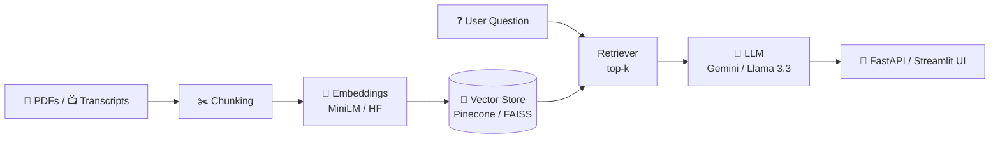

<!-- ═══════════════════════ HEADER ═══════════════════════ -->
<p align="center">
  
</p>

<p align="center">
  <a href="https://git.io/typing-svg">
    
  </a>
</p>

<p align="center">
  
  
  
</p>

<p align="center">
  <a href="https://www.linkedin.com/in/yarokhan"></a>
  <a href="mailto:yarkhanmuhammad586@gmail.com"></a>
  <a href="#-featured-projects"></a>
</p>

---

## 👋 About Me

I'm an **IT undergraduate at Bahria University Islamabad** (class of 2027) who loves building intelligent, data-driven software, the kind that goes beyond a notebook and runs as a real API with a real interface.

My work sits where **Generative AI**, **backend engineering**, and **data pipelines** meet: RAG systems, agentic workflows, FastAPI services, PostgreSQL schemas, and scrapers that feed them.

```python
class MuhammadYarKhan:
    role      = "Full-Stack AI & Backend Engineer (in the making)"
    education = "BS Information Technology @ Bahria University Islamabad, 2027"
    now       = "AI Intern @ Mentoga"
    based_in  = "Islamabad, Pakistan 🇵🇰"
    currently = ["RAG systems", "Agentic AI with LangGraph", "Portfolio & freelance work"]
    side_hustle = "Daraz seller + e-commerce automation"
    open_to   = ["Internships", "Freelance projects", "Collaboration"]
```

- 🔭 Building advanced **RAG pipelines** and **agentic AI workflows**
- ⚡ Bridging heavy ML models and **clean, production-minded web APIs**
- 🗄️ Designing **relational databases** properly: 3NF, triggers, views, window functions
- 🛒 Running a Daraz store and automating product workflows with scrapers
- 🤝 Looking for **internships at tech companies** and **freelance clients**

---

## 🛠️ Tech Stack

<p align="center">
  
</p>

| Category | Technologies & Tools |
| :--- | :--- |
| 🐍 **Languages** | Python 3, JavaScript (ES6+), TypeScript, PHP, SQL, HTML/CSS |
| 🤖 **Generative AI & LLMs** | LangChain, LangGraph, Google Gemini, Groq (Llama 3.3 70B), OpenAI, Anthropic, Hugging Face |
| 🔍 **Vector DBs & Retrieval** | Pinecone Serverless, FAISS, Sentence-Transformers, Semantic Search, Cosine Similarity |
| ⚙️ **Backend & APIs** | FastAPI, Uvicorn, Pydantic, SQLAlchemy, REST, Swagger/OpenAPI |
| 📊 **Data Science & ML** | scikit-learn, TensorFlow, XGBoost, LightGBM, pandas, NumPy, statsmodels |
| 🕷️ **Scraping & Automation** | Playwright, YouTube Transcript API, Chrome Extensions (Manifest V3) |
| 🗃️ **Databases** | PostgreSQL 16, SQL (joins, window functions, triggers, stored procedures) |
| ☁️ **Infra & Security** | Linux (Ubuntu), SSH, UFW, Fail2ban, Dante SOCKS5, Oracle/Azure/GCP VMs |
| 🖥️ **Frontend (pragmatic)** | Streamlit, vanilla JavaScript, HTML/CSS |

---

## 🌟 Featured Projects

<table>
  <tr>
    <td width="50%" valign="top">
      <b><a href="https://github.com/yarkhano/job-intelligence-platform">💼 Job Intelligence Platform</a></b>
      <p>A full-stack job search, scraping, and matching platform. Playwright collects listings from We Work Remotely, Rozee.pk and Remotive into a <b>3NF-normalized PostgreSQL</b> database (triggers, stored procedures, views, window functions), served by FastAPI with a Streamlit analytics dashboard.</p>
      <code>Python</code> • <code>FastAPI</code> • <code>PostgreSQL</code> • <code>Playwright</code> • <code>Streamlit</code>
    </td>
    <td width="50%" valign="top">
      <b><a href="https://github.com/yarkhano/Medical-Rag-Chatbot">🏥 Medical RAG Chatbot</a></b>
      <p>Ask questions about uploaded medical PDFs and get grounded answers. Built with LangChain, <b>Pinecone Serverless</b>, Groq (<b>Llama 3.3 70B</b>), MiniLM embeddings, and a FastAPI backend with a responsive web UI.</p>
      <code>LangChain</code> • <code>Pinecone</code> • <code>Groq</code> • <code>FastAPI</code>
    </td>
  </tr>
  <tr>
    <td width="50%" valign="top">
      <b><a href="https://github.com/yarkhano/Youtube-Chatbot">📺 YouTube Video RAG Chatbot</a></b>
      <p>Paste a YouTube link and chat with the video. Extracts transcripts, builds cached <b>FAISS</b> vector embeddings with Hugging Face, and answers through <b>Gemini 2.5 Flash</b> in a Streamlit interface.</p>
      <code>Python</code> • <code>Streamlit</code> • <code>FAISS</code> • <code>Google Gemini</code>
    </td>
    <td width="50%" valign="top">
      <b><a href="https://github.com/yarkhano/securevpn-chrome-extension">🔒 SecureVPN Chrome Extension</a></b>
      <p>A self-hosted Manifest V3 extension that routes browser traffic through authenticated <b>SOCKS5 proxies</b> (USA, UK, France) on hardened Ubuntu cloud VMs, complete with an automated server install script.</p>
      <code>JavaScript</code> • <code>Chrome API</code> • <code>Linux</code> • <code>SOCKS5</code>
    </td>
  </tr>
  <tr>
    <td width="50%" valign="top">
      <b><a href="https://github.com/yarkhano/customer-churn-prediction">📊 Customer Churn Prediction</a></b>
      <p>An end-to-end tabular ML pipeline: EDA, <b>SMOTE</b> for class imbalance, Logistic Regression, Random Forest and XGBoost, evaluated with ROC-AUC and F1. Caught and removed a <b>data-leakage</b> feature along the way.</p>
      <code>Python</code> • <code>XGBoost</code> • <code>LightGBM</code> • <code>scikit-learn</code>
    </td>
    <td width="50%" valign="top">
      <b><a href="https://github.com/yarkhano/FASTAPI-Project">📄 CAG Document Chat API</a></b>
      <p>A modular REST API built on <b>Cache-Augmented Generation</b>: upload PDFs, extract text with PyPDF, track documents by UUID, and query them through Google Gemini, with Swagger docs out of the box.</p>
      <code>FastAPI</code> • <code>Pydantic</code> • <code>PyPDF</code> • <code>Gemini API</code>
    </td>
  </tr>
</table>

### 🧬 How my RAG projects work



<details>
<summary><b>🧪 More projects (ML, NLP, scraping & more)</b></summary>
<br/>

| Project | What it does |
| :--- | :--- |
| [`sales-forecasting-timeseries`](https://github.com/yarkhano/sales-forecasting-timeseries) | Compares SARIMA, Holt-Winters, Exponential Smoothing and Random Forest; walk-forward forecasting with MAE/RMSE/MAPE |
| [`movie-recommendation-system`](https://github.com/yarkhano/movie-recommendation-system) | Collaborative vs. content-based filtering with TF-IDF and cosine similarity |
| [`image-defect-classification-cnn`](https://github.com/yarkhano/image-defect-classification-cnn) | CNN-based image defect classifier in TensorFlow |
| [`Spam-Email-Detector-Project`](https://github.com/yarkhano/Spam-Email-Detector-Project) | TF-IDF spam classifier served through a FastAPI prediction service |
| [`review-sentiment-classifier`](https://github.com/yarkhano/review-sentiment-classifier) | Sentiment analysis comparing Logistic Regression, Naive Bayes and SVM |
| [`darazscraper`](https://github.com/yarkhano/darazscraper) | Product scraping for Daraz e-commerce workflows |

</details>

---

## 🚀 My Learning Journey

```text
Python  ➜  Machine Learning  ➜  Deep Learning  ➜  NLP  ➜  FastAPI
                                                              │
   Cloud & Networking  ◀  Full-stack DBs  ◀  Vector DBs  ◀  LangChain & RAG  ◀  LangGraph & Agents
```

---

## 📈 GitHub Stats

<p align="center">
  
  
</p>

<p align="center">
  
</p>

---

## 🤝 Let's Work Together

I'm open to **internships at tech companies** and **freelance projects** in AI, backend and automation. If you need a RAG chatbot, a FastAPI backend, a scraper, or a data pipeline, reach out:

<p align="center">
  <a href="https://www.linkedin.com/in/yarokhan"></a>
  <a href="mailto:yarkhanmuhammad586@gmail.com"></a>
</p>

<p align="center">
  ✨ <i>"Building intelligent systems, one pipeline at a time."</i> ✨
</p>

<p align="center">
  
</p>
